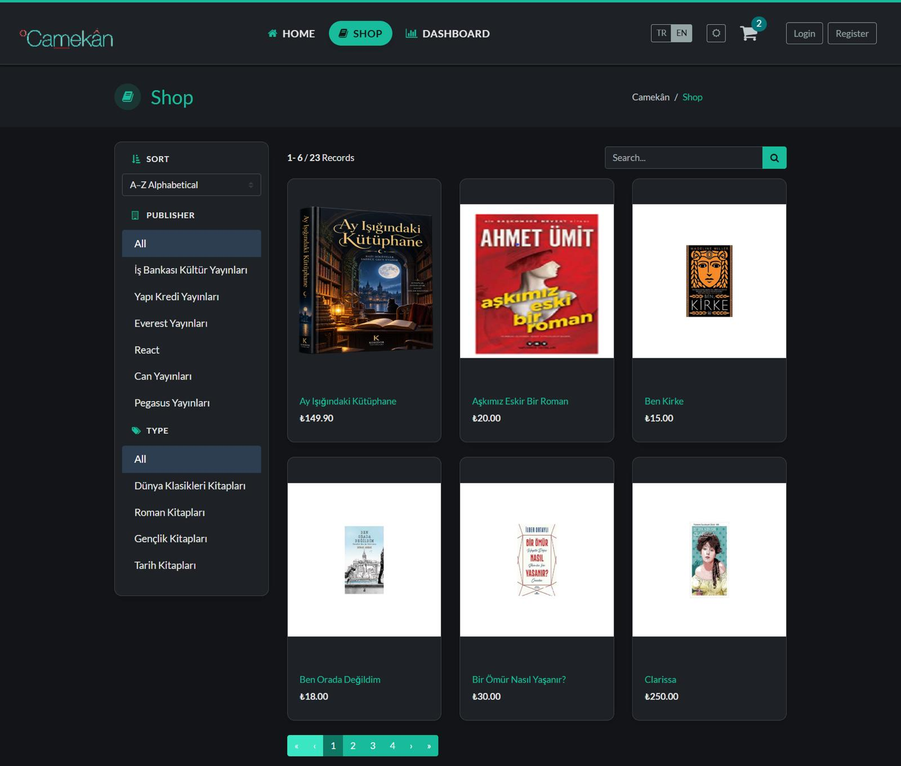
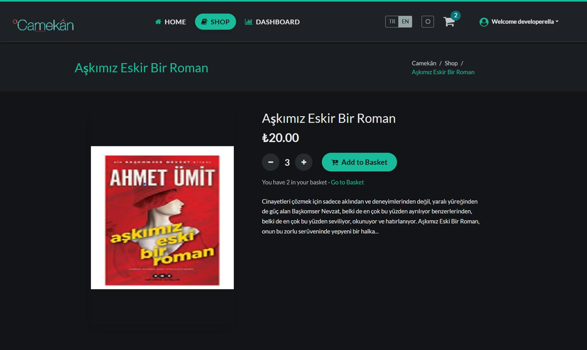
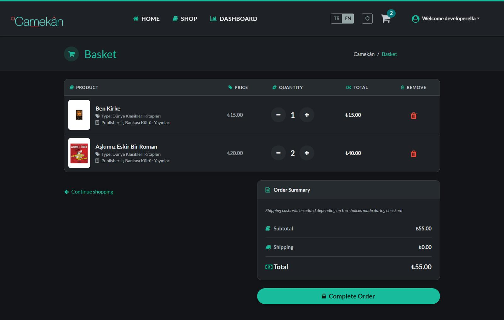
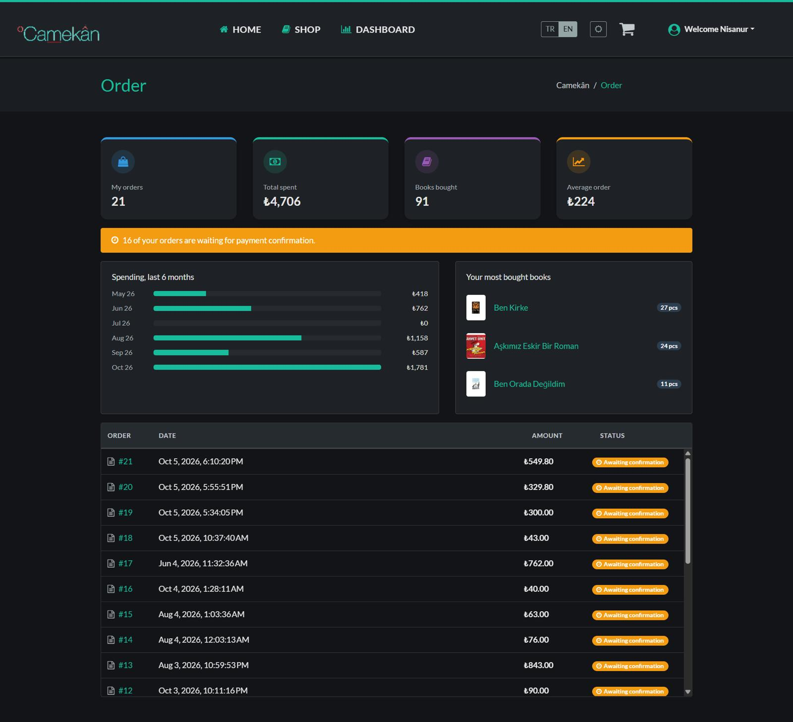
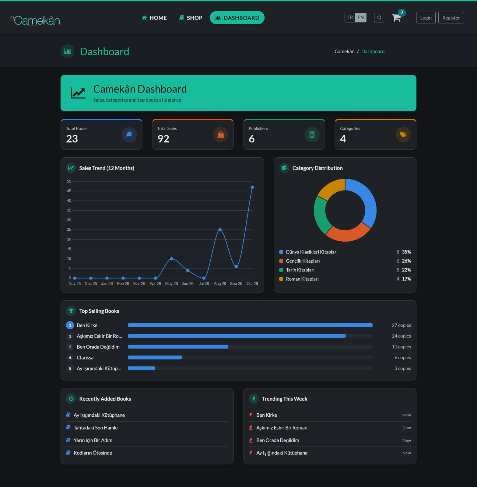
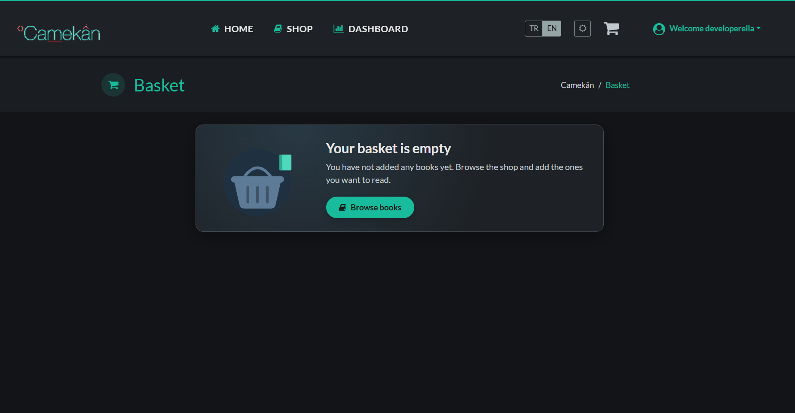
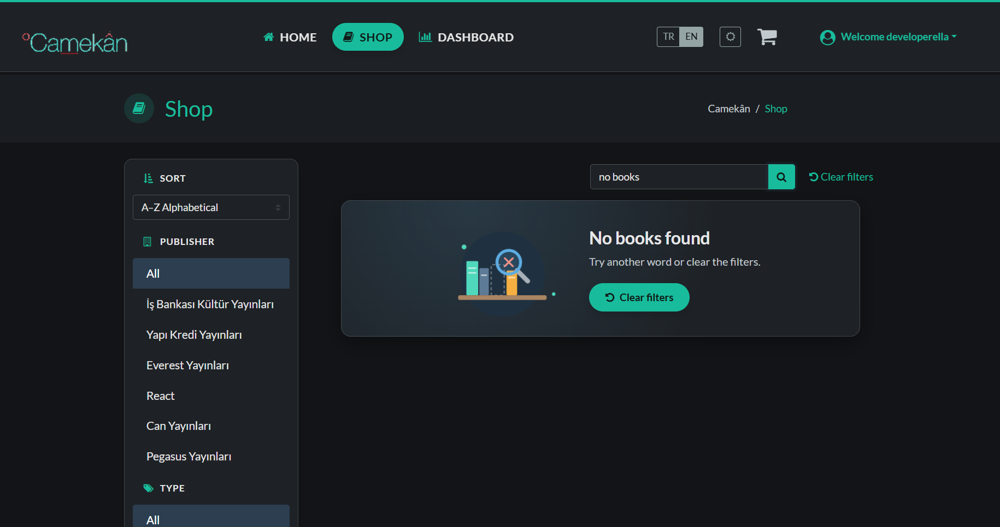
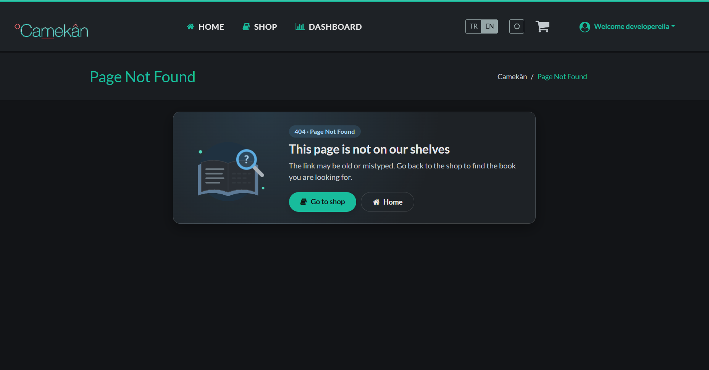
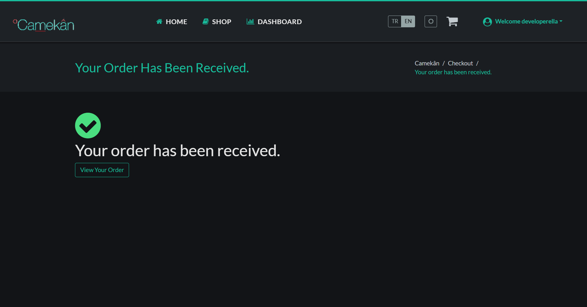

<p align="center">
  <a href="https://github.com/NisanurBulut/Camekan/stargazers">
    
  </a>
</p>

> [!TIP]
> **⭐ If this project helped you learn, please give it a star.** It takes two seconds and helps other developers find a complete .NET 10 + Angular 21 example with a real Stripe checkout.
<p align="center">
  <b>↗ Click the ⭐ Star button at the top right of this page ↗</b>
</p>

<hr>
<h1 align="center">Camekân</h1>

<p align="center">
  A bookstore demo with a real checkout: ASP.NET Core 10, Angular 21, Redis and Stripe.<br>
  Dark and light theme, Turkish and English.
</p>

<p align="center">
  
  
  
  
  
  
</p>

## Features

- **Shop:** search, sort, filter by publisher and type, paging
- **Basket:** kept in Redis, updates instantly, survives a page refresh
- **Checkout:** address, delivery, review and card payment with Stripe
- **Orders:** history list with a spending summary
- **Dashboard:** sales charts (Chart.js)
- **Accounts:** JWT login and ASP.NET Identity
- **Design:** dark and light theme, Turkish and English, empty and error states
- **API docs:** Scalar (OpenAPI) in development

<p align="center">
  <a href="Trailers/Camekan_shop.jpeg">
    
  </a>
</p>

## A quick tour

<table>
  <tr>
    <td align="center" width="50%">
      <a href="Trailers/Camekan_product_detail.jpeg"></a><br>
      <sub><b>1. Pick a book</b><br>Quantity picker and a live basket count</sub>
    </td>
    <td align="center" width="50%">
      <a href="Trailers/Camekan_basket.jpeg"></a><br>
      <sub><b>2. Review the basket</b><br>Change quantities, see the total, go to checkout</sub>
    </td>
  </tr>
  <tr>
    <td align="center">
      <a href="Trailers/Camekan_order_detail.jpeg"></a><br>
      <sub><b>3. Track your orders</b><br>Summary cards, 6-month spending and a fast order list</sub>
    </td>
    <td align="center">
      <a href="Trailers/Camekan_dashboard_detail.jpeg"></a><br>
      <sub><b>4. See the big picture</b><br>Sales trend, categories and top-selling books</sub>
    </td>
  </tr>
</table>

<details>
<summary><b>Empty, error and success states</b></summary>

<table>
  <tr>
    <td align="center" width="50%">
      <a href="Trailers/camekan_basket_empty.png"></a><br>
      <sub><b>Empty basket</b>: a clear next step</sub>
    </td>
    <td align="center" width="50%">
      <a href="Trailers/camekan_no_books.png"></a><br>
      <sub><b>No results</b>: filters stay in place</sub>
    </td>
  </tr>
  <tr>
    <td align="center">
      <a href="Trailers/camekan_not_found.png"></a><br>
      <sub><b>404</b>: "This page is not on our shelves"</sub>
    </td>
    <td align="center">
      <a href="Trailers/camekan_order_success.png"></a><br>
      <sub><b>Order received</b>: after the Stripe payment</sub>
    </td>
  </tr>
</table>

</details>

## Tech stack

| Layer | Tools |
|---|---|
| API | ASP.NET Core 10, EF Core 10 (SQLite), Identity, JWT, AutoMapper, FluentValidation |
| Cache and payments | Redis (basket, response cache), Stripe (PaymentIntents and webhook) |
| Client | Angular 21 (standalone, zoneless, signals), ngx-translate, Chart.js, Bootswatch |

## Quick start

```bash
# API (needs Redis on localhost:6379)
cd Camekan.API
cp appsettings.example.json appsettings.json   # add your Stripe keys and a Token:Key
dotnet run

# Client
cd Camekan.Client
cp src/environments/stripe-key.example.ts src/environments/stripe-key.ts
npm install
npm start
```

<details>
<summary><b>Architecture notes</b></summary>

(Move the current "Application Architecture" bullet list here.)

</details>

<hr/>

<p align="center">
  <b>Did this save you time?</b> A ⭐ on <a href="https://github.com/NisanurBulut/Camekan">GitHub</a> means a lot.<br>
  Found a bug or have an idea? <a href="https://github.com/NisanurBulut/Camekan/issues">Open an issue</a>, I read every one.
</p>